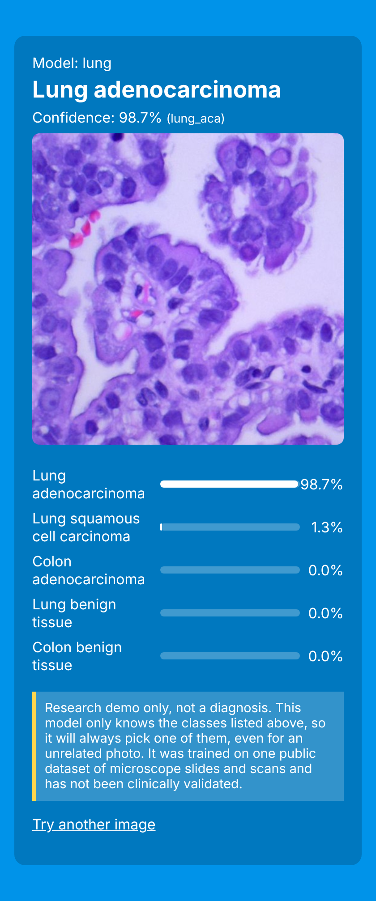

# Med-Pro: run it yourself

Runnable, fixed copy of [kumar11jr/Med_pro_webApp](https://github.com/kumar11jr/Med_pro_webApp)
(Apache-2.0). The setup script downloads the original project (about 830 MB, mostly the 8 model
files) and applies the fixes in `patch/`. Nothing from the original repo is stored here.

## What you need
- A laptop with Windows, macOS or Linux. A GPU is **not** needed. Around 3 GB of free disk space.
- **Python 3.10 to 3.13** (3.12 recommended) from python.org. On Windows, tick "Add Python to PATH".
- **Git** (git-scm.com).
- Internet for setup. After that the cancer pages work offline (only the OCR page needs internet).

## Run it
Windows: double-click `setup.bat`, wait (5 to 15 minutes), then double-click `run.bat`.

Mac/Linux:
```bash
./setup.sh
```
```bash
./run.sh
```
Then open **http://localhost:8000** in your browser and go to the cancer section.
Stop the server with Ctrl+C.

Test images are in `src/static/temp/<type>/`. The file name is the true answer, e.g.
`lung_aca_0002.jpg` is lung adenocarcinoma.

To score all 8 models on those images from the command line:
```bash
venv/bin/python tools/test_models.py src
```
(Windows: `venv\Scripts\python tools\test_models.py src`)

## What I fixed (`patch/views.py`, `patch/templates/disout.html`)
| Problem in the original | Effect |
|---|---|
| Images fed as raw BGR pixels, but models were trained on RGB scaled to 0-1 | Accuracy on bundled samples was 17/43. Fixed: 38/43 |
| Windows-only paths, a hard-coded `D:\medpro` path, NVIDIA CUDA reset after each prediction | Crashed on any other machine. Fixed: runs on CPU anywhere |
| Results decided by `prediction == 1.0` exact checks | Fragile. Fixed: picks the highest probability |
| Result page showed "Renal Carcinoma" for a *normal* kidney and "Oral Cancer" for *normal* oral tissue; a typo meant one cervical class never displayed; one result showed a crude placeholder text | Replaced with a page showing the label, confidence, every class probability and a disclaimer |
| OCR always sent `static/temp/a.jpg`, not your upload, using the author's API key | Fixed to send your upload; uses the ocr.space public demo key or `OCR_SPACE_KEY` env var |

## Test results (bundled sample images, after the fix)
| Model | What it was trained on (Kaggle "Multi Cancer" dataset) | Correct |
|---|---|---|
| brain | MRI scans: glioma / meningioma / pituitary tumor | 20/24 |
| lung (really lung + colon) | Microscope slides of tissue | 10/10 |
| breast | Ultrasound images | 2/2 |
| kidney | CT scans | 2/2 |
| cervical | Pap smear cell images | 2/2 |
| all (leukemia) | Blood smear images | 1/1 |
| lymph | Microscope slides | 1/1 |
| oral | Microscope slides | 0/1 |

These samples are very likely from the training data, so real accuracy will be lower.

## Limits you should know
- **Random static noise is classified with high confidence** (for example "kidney tumor" 98%,
  "oral squamous cell carcinoma" 99%). The models cannot say "this isn't a medical image".
- None of these models take ordinary photos. They expect microscope slides, MRI/CT, ultrasound or
  smear images in the same style as the training set. A phone photo of your mouth will not work with
  the oral model, which was trained on microscope slides.
- The "tumor segmentation" page is not real segmentation; it draws one box around the 128x128
  patch the brain classifier scores highest.
- The **liver disease page does not work** with current software: its models were saved with
  scikit-learn 1.2, which does not install on current Python. It shows an error message instead
  of crashing. (Liver disease is not cancer detection anyway.)
- The `KNNClassifier_93`, `rfc_99` etc. files are Python pickles. Loading a pickle can run code,
  so only load files from sources you trust. The `.h5` cancer models are plain CNN weights.
- Not a diagnostic tool. Do not use it on real patients.


